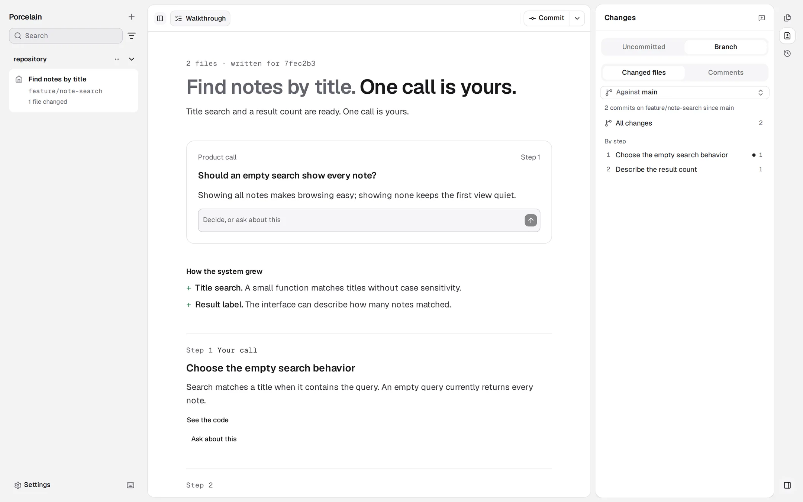

# Porcelain

Your agent built it. A fresh one explains it.

Porcelain hands a change to an agent that has never seen it. That agent reads the work and writes a **Walkthrough**: one page with what changed, how the system grew, and the few calls only you can make. Ask it anything. The agent that built the feature keeps working.

[Website](https://porcelain.fabiofiorita.com) · [Download](https://github.com/FabioFiorita/porcelain/releases) · [npm](https://www.npmjs.com/package/@fabiofiorita/porcelain)

<picture>
  <source media="(prefers-color-scheme: dark)" srcset="apps/marketing/src/assets/walkthrough-top-dark.webp">
  
</picture>

## Why

Agents write, run and test most of my code now. CI and reviewer agents catch the bugs. What is left for me is product and architecture: the calls a machine should not make alone, and keeping a picture of how the system grows when I did not write a line of it. A diff sorted by file name is a poor place to do either.

Asking the agent that built the feature to explain itself interrupts it, and it answers with everything it already assumes. So Porcelain asks someone else. If an agent with fresh eyes can follow the work, it was built well. If it cannot, you have found what to ask about.

Porcelain does not run your coding agent. It sits beside the one you already use, in the terminal, the desktop app or the editor. It is free, open source and has no account.

## What it does

- **One page per change.** The calls that need you first, then how the system grew, then one step per decision. When nothing needs you, it says so in one line.
- **What the code doesn't say.** The agent reads the pull request, the diff and the repository first. Then it reads only your own messages to the builder, and writes down whatever only those explained.
- **Proof where it belongs.** Screenshots from the pull request sit on the step they prove. The agent never edits code and never makes evidence up: no proof, nothing shown.
- **Ask, then post.** Comment on a call or a step and the walkthrough agent answers. A requested change goes on the pull request in one click, alone or saved and posted together, or is copied as a brief when there is no pull request.
- **Code by step.** The Changes panel groups committed and uncommitted work by step. Reviewed checkboxes stay on plain Changes.
- **Made for big repositories.** Pin the files you read, hide the ones you never open, and browse History as a commit graph with a timeline for each file, with commit, pull and push in the same place.
- **Every machine, one place.** Run a server where each repository lives and reach all of them from one Porcelain, locally, over your network or remotely.

## Install

**Mac app.** Download it from [GitHub Releases](https://github.com/FabioFiorita/porcelain/releases). It runs on Apple silicon.

**Server and browser.** On the Linux or Mac machine that holds your repositories, with Git and Node 24 (24.20+) or Node 26 (26.13+). Official Node 26 binaries on Linux also need the distribution’s `libatomic` runtime:

```sh
npx @fabiofiorita/porcelain@latest serve
```

Open the address it prints. The page shows the command that pairs this browser; run it on the same machine and open the link it prints. Then choose **Open project** and pick a repository.

On Linux, keep it running as a user service:

```sh
npx @fabiofiorita/porcelain@latest service install
```

**iPhone and iPad.** Coming soon.

`npx @fabiofiorita/porcelain@latest --help` lists every command, and the [npm readme](https://www.npmjs.com/package/@fabiofiorita/porcelain?activeTab=readme) covers sharing on your network, updates and recovery.

## Walkthroughs

Porcelain writes walkthroughs through the Claude Code (`claude`) or Codex (`codex`) CLI on the machine that runs the server. Install one and sign in; there is no API key to set up. Choose the writer's model and effort under **Walkthroughs** in Settings. A project's **Walkthrough settings**, in its menu, can choose another writer for that project and turn on automatic walkthroughs.

Choose **Write walkthrough** on a worktree with work to explain, or let the project write one when a pull request opens; automatic writing is off until you turn it on. New commits or edits mark the page out of date and offer **Update**.

The walkthrough agent runs read-only in the worktree: it reads and searches, and never edits. Your hooks and the MCP servers in your own agent configuration are switched off for it.

### Getting the most out of it

A walkthrough is only as rich as what its agent can read: your own words to your coding agent, a pull request that says what changed and how it was verified, and screenshots uploaded into that pull request's description. The [guide](https://porcelain.fabiofiorita.com/guide) shows what the agent reads and the habits that make a repository agent-ready, with instructions you can paste into your `AGENTS.md`.

## Privacy

Porcelain has no account, no analytics and no server of its own. Your code stays on your machine, with one exception you choose: the walkthrough agent, and commit message generation if you use it, run through your own Claude Code or Codex sign-in, so what they read goes to Anthropic or OpenAI under your account, as in any session you run yourself. That includes your own messages from the coding sessions in that worktree, which Porcelain reads locally to explain intent. Porcelain reads your pull requests through the GitHub CLI, signed in as you, and downloads the screenshots in a pull request's description from GitHub's image hosts. It posts a comment only when you click. The [privacy page](https://porcelain.fabiofiorita.com/privacy) has the details, and the source is right here.

## Contributing

Bug reports and ideas are welcome in [issues](https://github.com/FabioFiorita/porcelain/issues). Before you open a pull request, read [CONTRIBUTING.md](CONTRIBUTING.md): it covers the architecture, developing from source, and how changes are verified.

## License and thanks

Porcelain is released under the [MIT license](LICENSE). Thank you to:

- [T3 Code](https://github.com/pingdotgg/t3code), the main reference. It is an agent harness rather than a companion, and it met many of the same problems on the same stack first, remote environments especially.
- [Pierre](https://pierre.computer), which renders the code, the diffs and the file tree.
- [shadcn/ui](https://ui.shadcn.com), which the web components come from.
