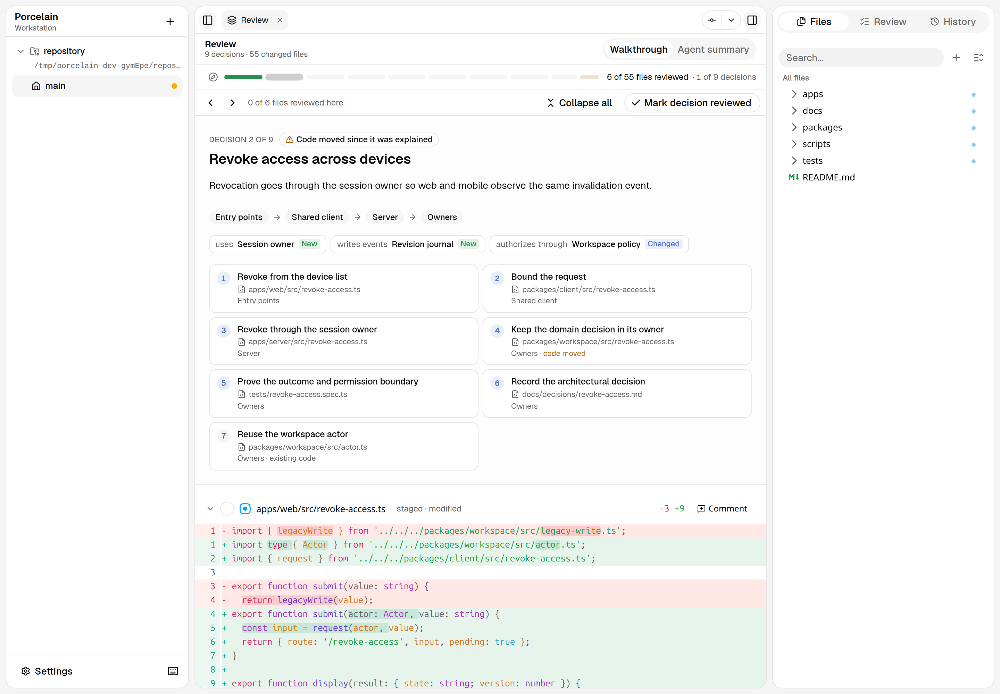
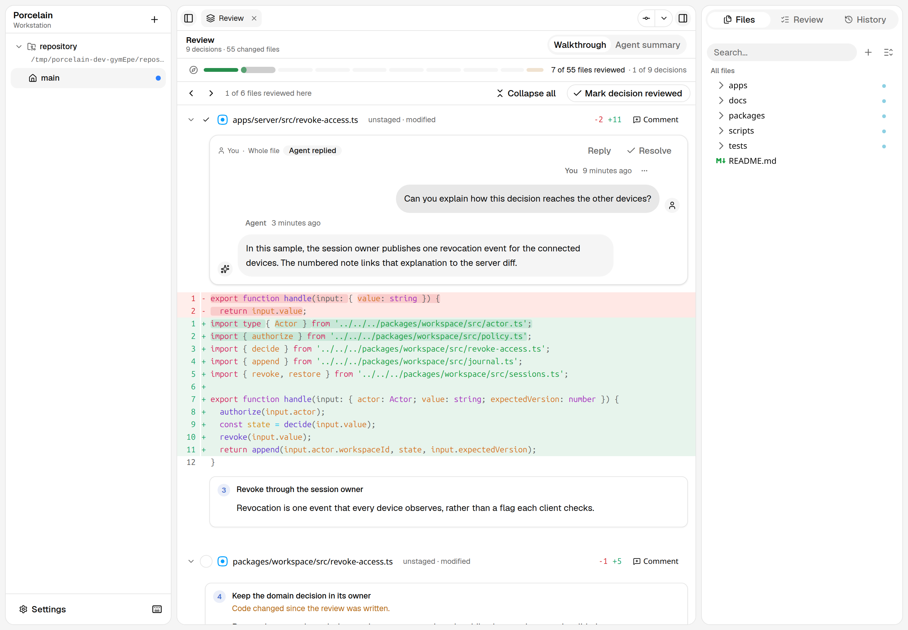
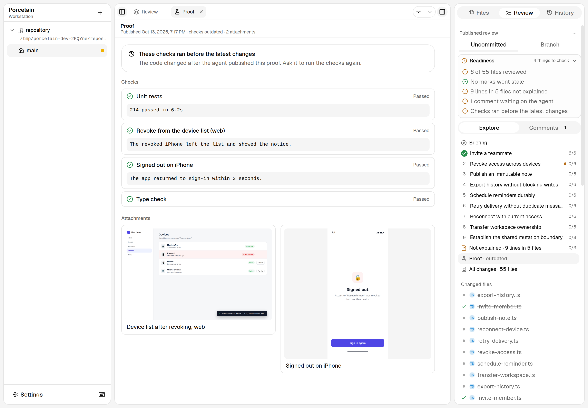

# Porcelain

Porcelain is a place to review a coding agent's work. The agent publishes a walkthrough of its decisions; you follow the explanation alongside the diffs, leave comments, and read the agent's replies.

It is for developers who run coding agents on their own machine and want to understand the result before deciding what to keep. A raw diff tells you what changed. Porcelain gives the agent a place to explain why, and gives you a way to ask about what it left unexplained.



*The screenshots use a disposable sample repository. Its features, comments and check results are illustrative.*

## What ships today

The [npm package](https://www.npmjs.com/package/@fabiofiorita/porcelain) contains the server and browser app. An Apple silicon Mac app is available from [GitHub Releases](https://github.com/FabioFiorita/porcelain/releases). The [mobile client](apps/mobile) lives in this repository; see the limitations below.

The browser review flow includes:

- A briefing and a stop for each decision, with diffs and numbered agent notes that lead you to the relevant code.
- A **Not explained** stop for changes outside the agent's explanation, with links back to decisions that contain unexplained lines.
- Reviewed marks on files, so you can keep track of what you have read.
- File comments and agent replies over MCP.
- A **Readiness** panel showing review progress, unexplained changes, comments and checks; **Proof** opens the checks and images attached to the review.



*A file comment and a reply sent through the sample MCP connection.*



*Proof displays what the agent reported; these sample results are not checks run on Porcelain itself.*

## Install and first use

The server needs macOS or Linux, Git, and **Node >=24.20.0 and <25**, as declared in [package.json](package.json). Start it on the machine that holds your repositories:

```sh
npx @fabiofiorita/porcelain@latest serve
```

Open the address it prints. The browser initially shows **This browser is not paired**, with a command to run on the server's machine. For the default local address, run this in another terminal:

```sh
npx @fabiofiorita/porcelain@latest pair "This browser" --address http://127.0.0.1:3000
```

Open the printed one-time link in that browser. Choose **Open project** (the plus button in the sidebar), browse to a Git repository on the server, and open it.

For agent publication and feedback over MCP, use the source-built package described in **Develop from source** below.

State defaults to `~/.porcelain/`. If you choose another location with `--data-directory`, use the same absolute directory for the server, pairing and MCP commands. The [package readme](https://www.npmjs.com/package/@fabiofiorita/porcelain?activeTab=readme) covers background services, sharing, updates and recovery. CLI options are available through:

```sh
npx @fabiofiorita/porcelain@latest --help
```

## Known limitations

- The Mac app's MCP setup is a [known issue (#247)](https://github.com/FabioFiorita/porcelain/issues/247). The npm-server instructions above do not establish a working MCP connection to the Mac app's private server.
- Mobile is a source development client, not a store release. Android still needs its own build and native verification; see the [mobile verification map](.agents/skills/mobile-verify/features/README.md).
- The server's background service installer targets Linux systemd user services. See the package readme for that separate setup.

## Plans

[GitHub issues](https://github.com/FabioFiorita/porcelain/issues) track proposed work and known bugs. They are not promises of shipped behaviour or release dates.

## Architecture and decisions

Porcelain is a TypeScript monorepo using pnpm, Turborepo and Effect. The server owns repositories and persistent state; the clients present that state and send commands.

| Path | Responsibility |
| --- | --- |
| [apps/server](apps/server) | HTTP, WebSocket and MCP entry points, server use cases, CLI and installer |
| [apps/web](apps/web) | React and Vite browser views |
| [apps/desktop](apps/desktop) | Electron host around the web app |
| [apps/mobile](apps/mobile) | Expo native client |
| [packages/contracts](packages/contracts) | Schemas for data crossing the wire |
| [packages/client](packages/client) | Shared client queries, commands, stores and rules |
| Domain packages under [packages](packages) | Access, changes, files, projects, reviews and Git actions |

- **The agent supplies the explanation.** The [MCP toolkit](packages/contracts/src/reviews/review-toolkit.ts) defines review publication and feedback; the [review guide](apps/server/src/http/mcp/review-guide.ts) tells agents how to explain their work.
- **Browser pairing and local agent access have different paths.** Browser devices pair with single-use links. The [MCP bridge](apps/server/src/cli/mcp-bridge.ts) relays an agent's standard input/output through a [local owner socket](apps/server/src/config/owner-socket-settings.ts), carrying its working directory.
- **Git remains Git.** Repository operations use the [Git CLI](packages/git/src/shared/commands/run-git.ts); persistent review and access data use SQLite with [migrations](packages/storage/drizzle).
- **Each layer has one job.** Features move from contracts through domain services, server use cases and the shared client to app views. [read-environment-service.ts](packages/access/src/services/read-environment-service.ts) shows the Effect service and Layer pattern. [Architecture checks](scripts/architecture.ts) and [dependency rules](architecture/dependency-cruiser.cjs) enforce the boundaries.

[AGENTS.md](AGENTS.md) is the development guide: it explains these decisions, testing, verification and pull requests.

## Develop from source

Use the Node version in [.node-version](.node-version) and the pnpm version named by `packageManager` in [package.json](package.json). Disposable server development also needs Git and either Linux with bubblewrap (`bwrap`) or macOS with `sandbox-exec`.

```sh
git clone https://github.com/FabioFiorita/porcelain.git
cd porcelain
pnpm install --frozen-lockfile
pnpm dev:review
```

Open the web address in the connection card and choose **Pair this browser**. The sample review opens with a briefing; choose **Continue with 2. Revoke access across devices**, then a numbered step to reach its diff and note. The card also prints the command that stops that disposable instance.

Build the server and browser app into the npm package:

```sh
pnpm build:package
```

The output is generated in `dist-porcelain/`, including its package readme. Pack it with `npm pack ./dist-porcelain`, then install the printed tarball into a separate directory with `npm install --prefix <directory> <tarball>`. This installs the runtime dependencies; the CLI is `<directory>/node_modules/.bin/porcelain`. Start it with `serve` and pair a browser with `pair`, using the same absolute `--data-directory` for all commands. Configure your agent's MCP client to run the built CLI's `mcp` command from the registered repository or worktree. The server must stay running. Ask the agent to read `porcelain://review-guide`, publish with `publish_review`, and read your feedback with `list_comments`; its replies appear in the browser's comment threads.

Check static rules and run a single named unit test, for example:

```sh
pnpm check:local
pnpm test --project @porcelain/client packages/client/src/features/reviews/rules/comments.spec.ts
```

Run the tests you changed by name; CI owns the full suites. For a feature's running proof, use the relevant [verification skill](.agents/skills) and its map, such as the [web feature map](.agents/skills/web-verify/features/README.md). Development uses disposable instances and profiles; never point verification at the installed app or its data.

## License and thanks

Porcelain is released under the [MIT license](LICENSE).

[T3 Code](https://github.com/pingdotgg/t3code) was Porcelain's main reference. It is a different product, an agent harness rather than a companion, that faced many of the same problems on the same stack. Porcelain learned from how it handled them, especially remote environments, and wrote its own code. Thank you to the T3 Code team.
