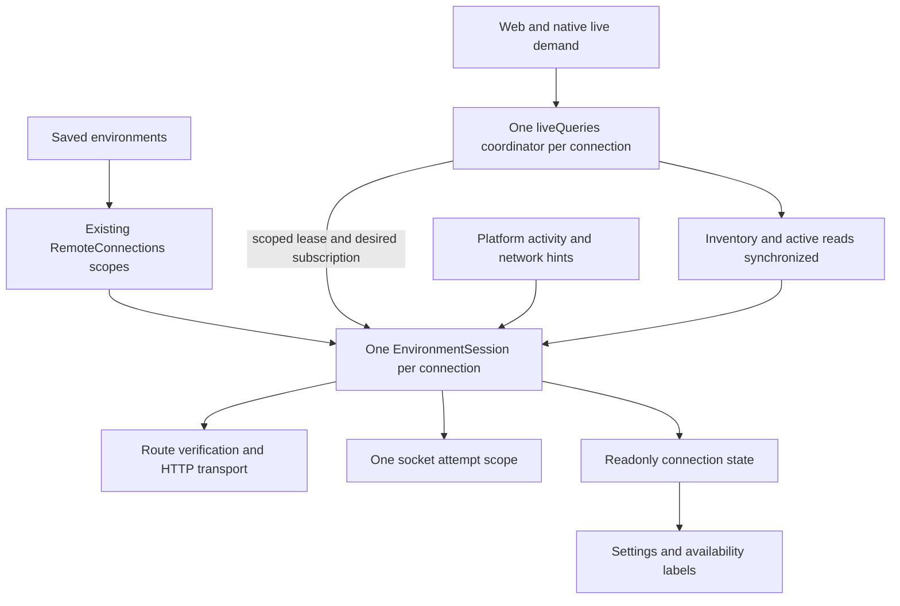

# Keep one session owner per environment

Status: proposed; decision required before implementation. This sketch is not executable production code and must not land alone.

Approve a shared, scoped session owner that preserves a healthy socket when an HTTP probe fails or the app regains focus. Keep the existing environment identity, saved routes, credentials, operation journals and draft protections. Do not add a new registry, persistence format, background route-upgrade scheduler or public RPC.

## What is established

Source baseline: [Porcelain 0d06ecd690b80d3e01446e9e3155e291884e04ad](https://github.com/FabioFiorita/porcelain/tree/0d06ecd690b80d3e01446e9e3155e291884e04ad), v0.73.0. The checkout and fetched main matched. Reference: [T3 Code 32ecd71726fee16f335484c1f95cbce126d461f6](https://github.com/pingdotgg/t3code/tree/32ecd71726fee16f335484c1f95cbce126d461f6), clean and read-only.

A fresh desktop-mode web journey used two real disposable servers and Chromium on Linux. Failing only the browser's remote `/api/health` requests made the remote Offline and closed its socket after 12 received frames. An independent request still returned 200 `application/json`. Restoring probe access recovered at the next status interval, about 30 seconds later. The local session remained available during the remote failure. A subsequent synthetic blur/focus transition closed the healthy replacement and opened another socket. This proves the lifecycle mechanisms, not an unexplained production network outage or native operating-system wake behavior.

Two fresh pairing contexts with one project and six saved reviews each made six detail and six marks requests before any review was opened. Sidebar visibility took 1,722/1,614 ms; all six branch rows settled in 2,148/2,478 ms. Vite was warm; pairing, navigation and browser startup work are included. No production latency percentile follows from two samples. The earlier independent audit also observed six details and six marks in each of two fresh saved-session contexts.

Read-only public requests from the desktop host to the server host currently found LAN health/environment 200 JSON, matching environment identity and protocol 3; the private-network hostname did not resolve; the public tunnel returned 403 plain text from its edge. No installed app session or credentials were opened. Those results differ from the historical incident, where LAN and the public tunnel answered and the private-network path failed.

Historical resource pressure is a separate observation: eight workers coincided with about 2 GiB available, 9.5 GiB swap and load 32.7; resources recovered after workers paused. It can delay both probes and synchronization. It does not prove today's socket failure. The HTTP gate and eager review loading already existed in v0.71.1; they were not introduced by the recent styling work.

## Who owns truth today

| Concern                           | Current owner and consequence                                                                                                                                                                                                                                                                                     |
| --------------------------------- | ----------------------------------------------------------------------------------------------------------------------------------------------------------------------------------------------------------------------------------------------------------------------------------------------------------------- |
| Saved identity, route credentials | `access/rules/remotes.ts` merges routes by environment ID and retains a credential/device ID per route. `RemoteConnections` owns one connection scope per saved configuration. This already supports multiple routes.                                                                                             |
| UI status                         | `access/queries/environments.ts` runs health → descriptor → authenticated session reads independently of the live socket. It probes routes sequentially; an unreachable result becomes Offline. Status activity and inventory notices can revalidate it.                                                          |
| Route selection                   | `access/store/route-transport.ts` has its own active route, failure set and selection semaphore. HTTP and socket setup share it; the independent UI status loop does not. Reads can fall back; writes are not automatically replayed.                                                                             |
| Desktop remote session demand     | `WorkspaceProvider.RemoteLive` passes a connection to `liveQueries` only when `remoteLiveOpen` sees Online. A failed HTTP probe therefore removes demand and closes a live session. Ordinary browser tabs keep their same-origin session; saved remotes open separately.                                          |
| Native mobile demand              | `allInventories` and the selected workspace mount `liveQueries`; they do not use the desktop status gate. Settings has a separate status query. Do not claim the desktop gate was reproduced on mobile.                                                                                                           |
| Socket recovery                   | `createLiveUpdates` owns RPC, retry backoff and desired subscriptions. Active transitions win `raceFirst` against the connection; `remoteLiveUpdates` resets route selection on foreground. Web desktop uses visibility/focus; mobile uses AppState. The local same-origin socket currently has no activity port. |
| Workspace freshness               | `live-queries.ts` refreshes operation receipts on ready and invalidates environment queries on reconnect. Notice processing runs asynchronous jobs. A server ready notice means neither inventory nor visible documents have finished refreshing.                                                                 |
| Server authority                  | Ticket issuance and upgrade authenticate the device and route. Revocation closes sockets with 4001; tunnel retirement uses 4003; capacity can close with 1013. The server sends ready/subscribed/heartbeat, pings peers and terminates unanswered connections. HTTP probes are not the sole health mechanism.     |
| Writes and drafts                 | Worktree connection scope, write queues, durable Git request identities and receipt recovery own interrupted writes. `EnvironmentCommands` saves drafts before changing routes or forgetting, then cleans selection and drafts. Socket replacement must not dispose this connection scope.                        |

Source owners: [status](https://github.com/FabioFiorita/porcelain/blob/0d06ecd690b80d3e01446e9e3155e291884e04ad/packages/client/src/features/access/queries/environments.ts), [routes](https://github.com/FabioFiorita/porcelain/blob/0d06ecd690b80d3e01446e9e3155e291884e04ad/packages/client/src/features/access/store/route-transport.ts), [connection lifetime](https://github.com/FabioFiorita/porcelain/blob/0d06ecd690b80d3e01446e9e3155e291884e04ad/packages/client/src/features/access/store/remote-connections.ts), [web demand](https://github.com/FabioFiorita/porcelain/blob/0d06ecd690b80d3e01446e9e3155e291884e04ad/apps/web/src/app/workspace-provider.tsx), [mobile demand](https://github.com/FabioFiorita/porcelain/blob/0d06ecd690b80d3e01446e9e3155e291884e04ad/apps/mobile/src/features/projects/queries/inventory.ts), [live recovery](https://github.com/FabioFiorita/porcelain/blob/0d06ecd690b80d3e01446e9e3155e291884e04ad/packages/client/src/features/live/commands/live-updates.ts), [refresh](https://github.com/FabioFiorita/porcelain/blob/0d06ecd690b80d3e01446e9e3155e291884e04ad/packages/client/src/features/live/commands/live-queries.ts), [server protocol](https://github.com/FabioFiorita/porcelain/blob/0d06ecd690b80d3e01446e9e3155e291884e04ad/apps/server/src/http/protocol/live-updates.ts), [server connections](https://github.com/FabioFiorita/porcelain/blob/0d06ecd690b80d3e01446e9e3155e291884e04ad/apps/server/src/runtime/live-updates/live-connections.ts), [Forget](https://github.com/FabioFiorita/porcelain/blob/0d06ecd690b80d3e01446e9e3155e291884e04ad/packages/client/src/features/access/commands/environments.ts).

## Behavior compared with T3 Code

| Element                  | Porcelain                                                                                                              | T3 reference                                                                                                                            | Recommendation                                                                                                                                              |
| ------------------------ | ---------------------------------------------------------------------------------------------------------------------- | --------------------------------------------------------------------------------------------------------------------------------------- | ----------------------------------------------------------------------------------------------------------------------------------------------------------- |
| Desired session          | Connection scope survives, but view-mounted live demand can disappear on HTTP status failure.                          | Registry owns environment scope; supervisor owns desired intent and active lease.                                                       | Keep existing connection registry; one scoped session owns demand independently of status.                                                                  |
| Failure meaning          | Several status answers exist, but route selection collapses most failures into a generic connection error.             | Typed transient/blocked failures and preparing/opening/synchronizing stages.                                                            | Keep per-route diagnosis; distinguish a recoverable outage from refusal. Never label an unreachable alternate as revoked.                                   |
| Ordinary foreground      | Cancels the connection and clears selected route.                                                                      | Probes the existing RPC session before replacement; coalesces wakeups.                                                                  | Probe/reuse, with no route reset or full environment refresh on a healthy answer.                                                                           |
| Long suspension          | Same boolean active transition as ordinary focus.                                                                      | Separate long-resume signal, frame activity and fresh host checks help detect a silently dead socket.                                   | Carry elapsed inactivity and network/wake hints; check existing RPC and inbound activity. Replace a silent or failed session, not every resumed session.    |
| Readiness                | Ready notice triggers work that may still be pending.                                                                  | Driver awaits `session.ready`, including validated initial server configuration. This is not proof all workspace documents are current. | Separate authenticated transport, accepted subscription and workspace freshness. Await mandatory refresh before reporting workspace current.                |
| Route discovery          | Two sequential probe loops; active route is sticky until failure or foreground reset.                                  | Overlapping public route checks, preferred-route head start, preflight and cooldowns for upgrades.                                      | Share one set of checks; overlap public checks during recovery. Keep healthy fallback pinned. Omit automatic upgrades and their cooldown machinery for now. |
| Identity and credentials | Environment ID and per-route credentials already persist; operationIdentity protects the journal across route changes. | Registry groups by environment; prepared sessions bind target and authorization; initial config checks environment ID.                  | Preserve existing identities and route-bound credentials. Verify public identity/protocol before credentialed setup.                                        |
| Navigation data          | Review list reads each review's details/marks and linked PR data; broad reconnect invalidation re-fetches them.        | Project atoms derive stable environment-scoped shell snapshots and references.                                                          | Measure this amplifier; summary-first navigation is a separate concern, not a prerequisite to correcting socket ownership.                                  |

T3 sources: [model](https://github.com/pingdotgg/t3code/blob/32ecd71726fee16f335484c1f95cbce126d461f6/packages/client-runtime/src/connection/model.ts), [supervisor](https://github.com/pingdotgg/t3code/blob/32ecd71726fee16f335484c1f95cbce126d461f6/packages/client-runtime/src/connection/supervisor.ts), [driver](https://github.com/pingdotgg/t3code/blob/32ecd71726fee16f335484c1f95cbce126d461f6/packages/client-runtime/src/connection/driver.ts), [registry](https://github.com/pingdotgg/t3code/blob/32ecd71726fee16f335484c1f95cbce126d461f6/packages/client-runtime/src/connection/registry.ts), [routes](https://github.com/pingdotgg/t3code/blob/32ecd71726fee16f335484c1f95cbce126d461f6/packages/client-runtime/src/connection/routes.ts), [wakeups](https://github.com/pingdotgg/t3code/blob/32ecd71726fee16f335484c1f95cbce126d461f6/packages/client-runtime/src/connection/wakeups.ts), [connectivity](https://github.com/pingdotgg/t3code/blob/32ecd71726fee16f335484c1f95cbce126d461f6/packages/client-runtime/src/connection/connectivity.ts), [RPC session](https://github.com/pingdotgg/t3code/blob/32ecd71726fee16f335484c1f95cbce126d461f6/packages/client-runtime/src/rpc/session.ts), [project projection](https://github.com/pingdotgg/t3code/blob/32ecd71726fee16f335484c1f95cbce126d461f6/packages/client-runtime/src/state/projectEntities.ts). These are source comparisons; T3's runtime was not tested and is not assumed perfect.

## Chosen shape: session inside the existing connection

The existing connection scope owns the session; a nested attempt scope owns its socket. Live demand acquires a scoped lease. Settings reads a projection; it cannot cancel demand. Multiple UI consumers share the same connection's query coordinator and lease. A generation prevents old socket/probe/refresh completions from publishing into a replacement.



Proposed modules, not additional packages: `live/ports/environment-session.ts` declares the public view and lease; `live/commands/environment-session.ts` owns lifecycle transitions; route verification moves to `access/api/verified-route.ts`; route selection remains private to the session implementation. `live/commands/live-queries.ts` remains the query/synchronization owner. No app imports lifecycle internals. Existing worktree/runtime, write queues and recovery scopes stay outside socket attempts. The design screen has one writer of session state, one connection operation instead of caller-driven reset/select/open coordination, a derived saved-route list, and one exported lifecycle path. Query synchronization reports a result through the lease; it cannot write transport state.

Data and signatures below use existing `Remote`, `ConnectionRoute`, `Transport`, `LiveSubscription`, `LiveNotice`, Effect `Socket`, `Scope` and `AtomRef` types. `SessionActivity` replaces the boolean-only activity port; its adapter supplies elapsed inactivity, not a preselected timeout policy. Bodies deliberately throw.

```ts
type RouteFailure = {
  readonly address: string;
  readonly reason: 'unreachable' | 'unauthorized' | 'foreign' | 'incompatible';
};

type SessionRoute =
  | { readonly kind: 'browser' }
  | { readonly kind: 'saved'; readonly address: string };

type SessionLink =
  | { readonly kind: 'idle' }
  | { readonly kind: 'connecting'; readonly stage: 'verifying' | 'opening' }
  | {
      readonly kind: 'connected';
      readonly generation: number;
      readonly route: SessionRoute;
      readonly workspace: 'refreshing' | 'current' | 'failed';
    }
  | { readonly kind: 'reconnecting' }
  | { readonly kind: 'blocked' };

type SessionState = {
  readonly link: SessionLink;
  readonly environment: ReadEnvironmentResponse | undefined;
  readonly routeFailures: readonly RouteFailure[];
};

type SessionWakeup =
  | { readonly kind: 'active'; readonly inactiveMs: number }
  | { readonly kind: 'network-changed' };

type SessionActivity = {
  readonly subscribe: (changed: (event: SessionWakeup) => void) => () => void;
};

type SessionTarget =
  | {
      readonly kind: 'saved';
      readonly remote: Remote;
      readonly send: AccessPlatformValue['send'];
      readonly socket: (url: string) => Effect.Effect<Socket.Socket>;
      readonly activity: SessionActivity;
    }
  | {
      readonly kind: 'browser';
      readonly environmentId: string;
      readonly transport: Transport;
      readonly openSocket: Effect.Effect<Socket.Socket, never, Scope.Scope>;
      readonly activity: SessionActivity;
    };

type Synchronize = (input: {
  readonly generation: number;
  readonly replacement: boolean;
}) => Effect.Effect<void, ConnectionError>;

type SessionLease = {
  readonly subscribe: (desired: LiveSubscription) => void;
};

type EnvironmentSession = {
  readonly state: AtomRef.ReadonlyRef<SessionState>;
  readonly transport: Transport;
  readonly connect: (handlers: {
    readonly onNotice: (notice: LiveNotice) => void;
    readonly synchronize: Synchronize;
    readonly onUnauthorized: () => void;
  }) => Effect.Effect<SessionLease, never, Scope.Scope>;
};

function makeEnvironmentSession(
  target: SessionTarget,
): Effect.Effect<EnvironmentSession, never, Scope.Scope> {
  throw new Error('not implemented');
}
```

Three caller sketches:

1. `openRemoteConnection` obtains a session in its existing lifetime scope. Web's remote factory and mobile's remote factory both yield this operation; they stop wrapping a synchronous opener in `Effect.sync`. The same-origin factory uses the browser target, preserving cookies and the desktop bridge URL.

```ts
const session =
  yield *
  makeEnvironmentSession({
    kind: 'saved',
    remote,
    send: platform.send,
    socket,
    activity,
  });
return openLiveConnection(
  {
    ...connectionInput,
    transport: session.transport,
    session,
  },
  platformLayer,
  memoMap,
);
```

2. `liveQueries` acquires demand and reports refresh completion through one awaited hook. It becomes canonical by connection alone; authorization callbacks belong to the connection's platform lifecycle adapter, not the atom family key. Existing read-subscription and receipt stores supply the hook. A failed refresh reports failed freshness without destroying a usable socket.

```ts
const lease =
  yield *
  connection.session.connect({
    onNotice: scheduleNotice,
    synchronize: ({ generation, replacement }) =>
      synchronizeActiveReads(connection, { generation, replacement }),
    onUnauthorized: connection.onUnauthorized,
  });
lease.subscribe(desired);
```

`scheduleNotice` is the current scoped notice-job callback; it schedules `applyNotice` rather than returning an unexecuted Effect to a void callback. `synchronizeActiveReads` is the extraction from the existing query coordinator, not a second cache: on replacement invalidate environment once, settle inventory and the captured active-read registrations, and reconcile pending receipts with explicit unknown outcomes. On first connection reuse a valid inventory seed. Later reads register normally. A draft/read failure does not turn every environment Offline.

3. `RemoteLive` mounts demand whenever this client supports background remote sessions. Status rendering reads `connection.session.state`; it never supplies the demand condition. Mobile inventory/workspace consumers keep their entry points and share the same coordinator. Browser-only saved remotes retain HTTP-only diagnostics when no live lease is desired.

```ts
useLiveQueries(desktopShell ? remote.connection : null);
const status = useConnectionStatus(remote.connection);
```

The HTTP-only diagnostic task is internal to the same session owner, pauses with activity, and cannot close a leased socket on an unreachable result. `link: idle` with verified metadata and no route failure means HTTP availability, not a live connection; metadata is stale when verification fails. Connected transport and failed workspace refresh are likewise distinct. Metadata refresh is retained; no second independent status scheduler is exported.

## Different alternative: event reducer with separate interpreters

Keep HTTP status, socket and route effects separate, but make them feed one pure reducer. The reducer emits commands for interpreters instead of holding a scoped lease itself.

```ts
type ConnectionEvent =
  | { readonly kind: 'demand'; readonly desired: boolean }
  | { readonly kind: 'wake'; readonly event: SessionWakeup }
  | {
      readonly kind: 'route-result';
      readonly generation: number;
      readonly result:
        | { readonly kind: 'verified'; readonly route: ConnectionRoute }
        | { readonly kind: 'failed'; readonly failure: RouteFailure };
    }
  | { readonly kind: 'socket-ended'; readonly generation: number }
  | { readonly kind: 'synchronized'; readonly generation: number };

type ConnectionCommand =
  | { readonly kind: 'check-routes'; readonly generation: number }
  | {
      readonly kind: 'open-socket';
      readonly generation: number;
      readonly route: ConnectionRoute;
    }
  | { readonly kind: 'probe-socket'; readonly generation: number }
  | { readonly kind: 'close-socket'; readonly generation: number }
  | { readonly kind: 'refresh-workspace'; readonly generation: number };

type ReducerState = {
  readonly desired: boolean;
  readonly generation: number;
  readonly session: SessionState;
};

function reduceConnection(
  state: ReducerState,
  event: ConnectionEvent,
): {
  readonly state: ReducerState;
  readonly commands: readonly ConnectionCommand[];
} {
  throw new Error('not implemented');
}
```

Reducer data/rules would live in `live/rules/connection.ts`; separate command interpreters in `live/commands/` would own probes, routes, sockets and refresh. This offers deterministic transition tests, but needs an additional intent state, command queue, cancellation protocol and resource interpreter. It exposes generation/coordination across several modules and risks several writers of resource state. The scoped session hides those details behind the smaller API and matches existing Effect resource ownership. Neither alternative has been implemented or runtime-compared; choosing between them does not depend on a performance claim.

A gate-only patch is smaller still: mount RemoteLive unconditionally and remove foreground reset. It fixes the demonstrated closure but leaves half-open sockets, status disagreement, synchronization and parallel route ownership unresolved. It is not the proposed complete repair.

## Rules the implementation must preserve

- A public probe failure is route evidence, not proof that an authenticated RPC socket died. Probe the current socket using the existing `follow` RPC and its completion; serialize this with subscription updates and wait for the current desired subscription. Do not add a new ping RPC. Inbound frames prove transport activity, not successful workspace synchronization.
- A real close, failed RPC probe, or confirmed silent session causes one replacement attempt. Coalesce wakeups; do not interrupt an opening attempt on ordinary focus. After long inactivity mark data refreshing, probe, and replace only when the socket fails or remains silent through the measured recovery deadline. A successful probe settles the current session; it does not invalidate the whole environment.
- A current-route 401 or 4001 closes that route's session immediately. Foreign identity or incompatible protocol quarantines that route before credentialed setup. Probe health/descriptor anonymously, then use only that route's credential. Do not send credentials to an unverified alternative. HTTP edge 403 is not automatically device revocation. If another route remains unreachable, retain its transient diagnosis instead of claiming every credential was revoked.
- During disconnected recovery, public identity checks overlap within one bounded attempt. Try a verified responsive route without waiting serially for every dead preferred route. Authenticated socket attempts remain sequential; retire a failed attempt before the next. Exclude a socket-failing route until alternatives have been tried, even if its HTTP health is good. Keep the existing deadlines/backoff until measurements justify changing them.
- A healthy fallback stays selected until loss or an explicit saved-route change. Ordinary focus does not re-prefer a failing route. There is no automatic better-route upgrade and hence no upgrade bounce/cooldown loop to implement in this change.
- Keep environment ID and operationIdentity stable across attempts and fallback. Route/device credentials remain bound to their routes. Re-pairing or editing the saved configuration closes its old scope; late answers cannot repopulate it. No persisted migration is proposed.
- Retry only safe reads through fallback. Never automatically resend an uncertain write because a socket changed. Preserve the durable Git request identity and reconcile receipts; existing user-directed recovery can resend that exact identity. An unknown outcome stays visible. Keep draft save/Forget guards and selection cleanup. Forget releases demand, attempts and activity listeners; it does not revoke the host credential.
- A synchronization error leaves workspace data explicitly stale/failed. Ready requires accepted subscription and the mandatory inventory/active-read refresh; recovery of a pending write may remain explicitly unresolved. One unavailable environment must not block another environment's navigation or readiness.

## Replacement and implementation sequence

After approval, implement on this decision branch. The complete replacement is one concern; do not land both lifecycle paths as a staged compatibility layer.

1. Derive regression cases from the demonstrated promises. Add the real-server browser regression for healthy-socket HTTP-probe loss; prove it fails on the baseline. Capture ordinary foreground, silent wake and route failure promises with controlled port events and Effect's test clock. Change the existing tests that explicitly promise unconditional foreground replacement; retain their teardown and authorization coverage.
2. Build the scoped session inside `packages/client` and migrate both saved and browser targets. Move verified route reads out of the status query module. Replace `createRouteTransport`, `createLiveUpdates` and `remoteLiveUpdates` with this single owner; remove their old lifecycle exports, `onForeground: routing.reset`, and exported mutable reset/select/failed coordination. Port the meaningful old tests to their new owner; remove forwarding and duplicate tests.
3. Make `liveQueries` canonical per connection, replace its fire-and-forget reconnect hook with awaited synchronization, and project status from the session. Remove `remoteLiveOpen` and its Online gate/tests, the independent status atom loop and `statusChanges/statusRuntime` signaling. Migrate status/recheck/settings-update callers directly. Retain metadata queries, genuine auth reactions, safe-read fallback and existing operation/draft owners.
4. Migrate web/Electron and native activity adapters and factories in the same change. Preserve sidebar, Settings/detail, deep-link restoration, selected workspace, route preference, Pair again, Forget and return navigation. No styling or unrelated mobile backlog work. Native capability differences supply events; they do not implement separate lifecycle policies.
5. Run the bounded proof below, retain sanitized evidence and cleanup, obtain the allowed fresh review, and open the implementation for exact-head checks and owner approval. Keep the decision designation; document any change from this sketch. Do not merge the sketch by itself.

## Verification and measurement contract

The current investigation proves Linux desktop-mode web on disposable loopback servers, read-only public route reachability from a remote desktop host, and source ownership. It does not prove native Electron, iPhone, iPad, Android, OS sleep, authenticated WAN sockets, revocation recovery, interrupted writes or slow preferred-route fallback at runtime. Those are implementation acceptance gates, not passed checks. No independent fresh-context reviewer was used because this investigation explicitly excludes other agents.

| Journey                               | Required observation before calling implementation done                                                                                                                                                                                                                                                                                 |
| ------------------------------------- | --------------------------------------------------------------------------------------------------------------------------------------------------------------------------------------------------------------------------------------------------------------------------------------------------------------------------------------- |
| Cold start with accumulated work      | Use the measured one-project/six-review fixture and a larger retained-history fixture. Record API counts/bytes, first sidebar, settled sidebar, socket subscription and selected-workspace readiness separately. No review is opened for the initial count. Compare identical saved-session reloads, build mode and route before/after. |
| Healthy socket, health HTTP failure   | Fail only remote health in browser routing; see ongoing frames and a new real fixture notice, zero socket replacements and independent health 200. Show degraded route diagnostics without false Offline. Local environment remains usable.                                                                                             |
| Ordinary foreground and event bursts  | Keep a healthy socket through real app focus and controlled active events; no new ticket/socket, whole-environment refresh or route reset. A pending attempt finishes once.                                                                                                                                                             |
| Long sleep/wake                       | On native desktop and mobile, background/suspend and wake. Drive live, silent-without-close and actually closed cases separately. Check probe result, frame activity, generation, freshness and bounded replacement. Timer throttling and missed network events are explicit cases.                                                     |
| Actual transport loss                 | Close the upstream socket with probes still healthy, then remove connectivity. See one retry owner, backoff, fallback and eventual refresh; UI exposes the outage. Repeated signals do not multiply attempts.                                                                                                                           |
| Slow/dead preferred, healthy fallback | Keep the preferred public check pending while fallback answers; verify prompt fallback selection. Also make preferred HTTP healthy but its socket fail. Check per-route credentials/identity, no write replay and no focus-induced bounce.                                                                                              |
| Authorization and identity            | Revoke active route (4001/401), keep one valid alternate; then all revoked; then revoked plus unreachable alternate. Check route-specific diagnosis, blocked versus reconnecting, explicit re-pair and successful recovery. Wrong ID/protocol receives no credentialed setup. Edge 403 remains distinct.                                |
| Forget and interrupted work           | Hold a write response after server acceptance, replace socket and reconcile the same receipt/request ID. Exercise draft-save refusal, Forget, route edits and late completions. No duplicate write, silent outcome success or discarded draft.                                                                                          |

Named proof homes: `packages/client/src/features/live/commands/live-updates.spec.ts`, `live-queries.spec.ts`, `live-connection.spec.ts`; `packages/client/src/features/access/queries/environments.spec.ts`; existing route-transport and environment-command tests; `apps/web/spec/e2e/access-remote-computers.desktop.e2e.ts`, `access-remote-detail.desktop.e2e.ts`, `access-restore-outage.e2e.ts`, `apps/web/spec/integration/git-actions-follow-receipt.test.tsx` and `apps/web/spec/e2e/git-actions-reload-running.e2e.ts`. Add the missing live-status regression to the existing desktop connection journey. Run changed files by name, local static checks, disposable server/web proof and native desktop/mobile proof; no whole local suites or parallel heavy runners. Every new behavioral test must fail with its protected behavior reverted. No sleeps, retry allowances, timeout inflation or weaker assertions.

The measured initial read budget is six details plus six marks for six reviews; this connection change must not add a second fanout on healthy focus or probe failure. The event budget is zero replacement sockets and zero full refreshes for a healthy foreground/probe-failure journey. These are behavioral counts supported by the reproduction, not invented latency targets. Startup latency is still unbudgeted: collect repeated saved-session samples on the production build over each actual route, with retained-history size, payload bytes, RTT, scheduler delay and memory pressure recorded. Set a per-route regression bound and a silent-session deadline from those distributions before implementation signoff; report sample count/range and uncertainty, not a percentile from two development runs. If measurements require a new timer or protocol field, return that decision instead of silently expanding this sketch.

## Accepted costs and decisions requested

The session keeps a healthy authenticated socket despite a failed public check; route diagnostics can temporarily disagree with transport health. A genuinely silent connection still needs a measured probe deadline. Keeping fallback pinned can sacrifice a faster preferred route until the session ends or the user changes preference. The repair does not reduce eager review-list payloads, fix host resource exhaustion, repair private DNS or change tunnel policy. A connection cannot make an unavailable route healthy.

1. Approve this scoped session shape and the direct migration/deletion of the existing lifecycle owners, with no public contract or persistence migration.
2. Accept pinned healthy fallback and defer automatic route upgrades and review-summary optimization. Measurement and native acceptance gates above remain required before implementation is declared complete.
